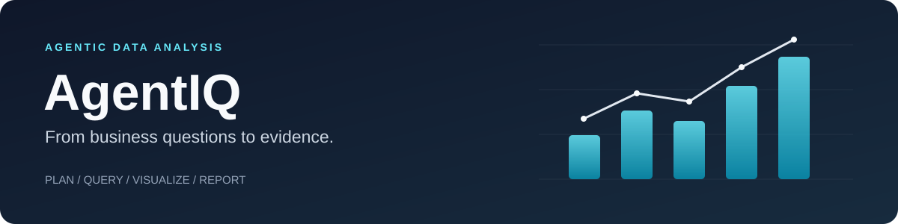
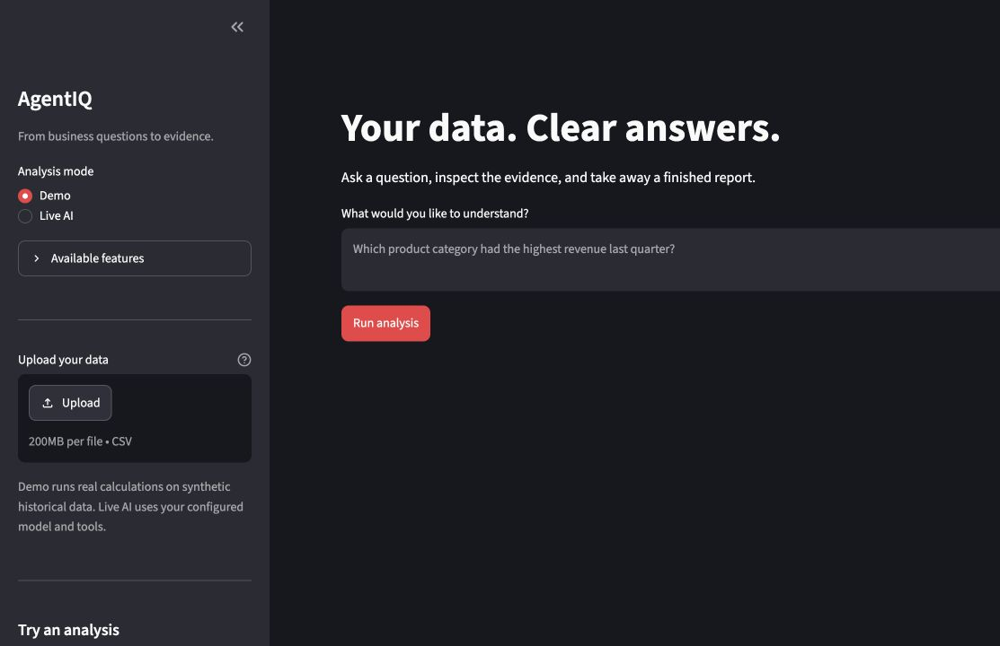
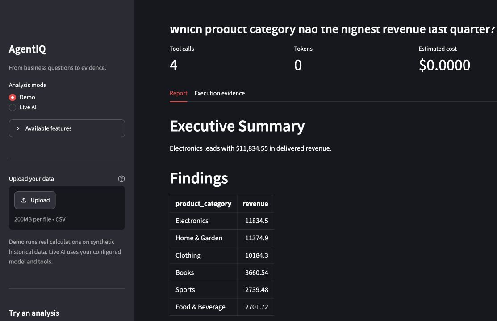
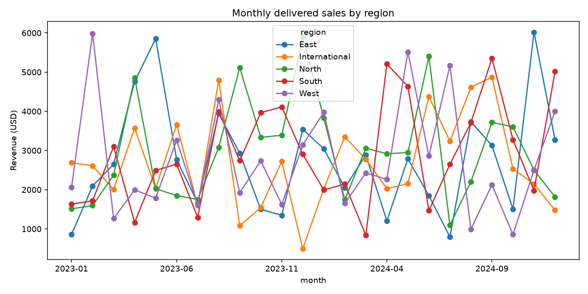
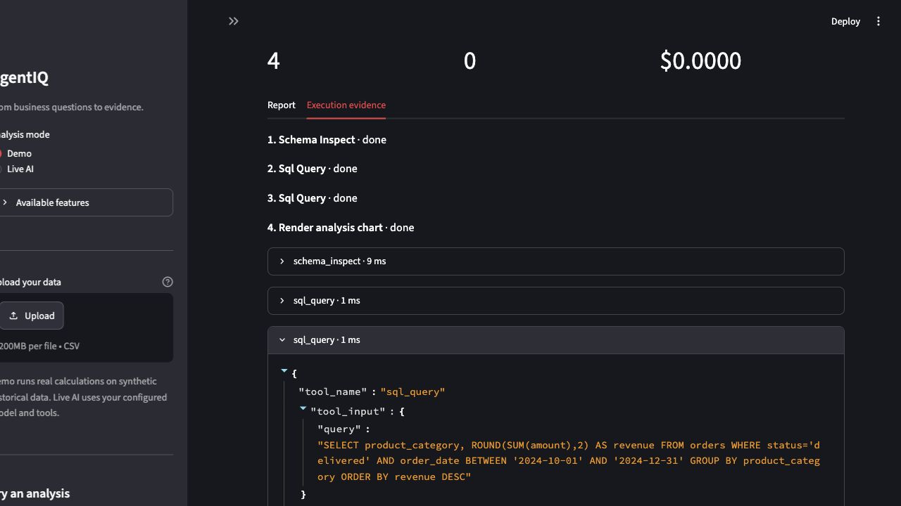
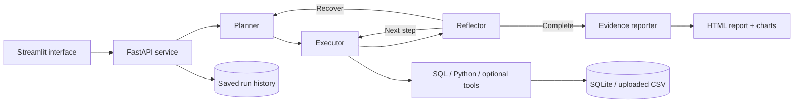

<p align="center">
  
</p>

<p align="center">
  <a href="https://agentiq-9jrm.onrender.com"><strong>Live demo</strong></a> ·
  <a href="#quick-start">Quick start</a> ·
  <a href="docs/ARCHITECTURE.md">Architecture</a> ·
  <a href="docs/DEPLOYMENT.md">Deployment</a> ·
  <a href="docs/VERIFICATION.md">Verification</a>
</p>

<p align="center">
  <a href="https://github.com/Navaneeth-007/AgentIQ/actions/workflows/ci.yml"></a>
  
  
  
  
</p>

**AgentIQ turns natural-language questions into SQL-backed findings, charts, and downloadable reports.** A Streamlit interface connects to a FastAPI service, where a LangGraph agent plans an analysis, executes tools, checks progress, and assembles evidence from actual query results.

Built as an end-to-end portfolio project: an interactive product, an inspectable agent workflow, automated tests, and a working Docker deployment on Render.

## Preview



<details>
<summary><strong>View the report and execution evidence</strong></summary>

### Revenue report



### Generated regional chart



### Inspectable tool execution



Screenshots show the real local interface running a demo against synthetic sample data. Demo calculations execute real SQL and Python; they do not call an LLM.

</details>

## Features

| Capability | What it does |
| --- | --- |
| Natural-language analysis | Plans and executes database analysis using Groq, with configurable Anthropic and OpenAI-compatible alternatives. |
| CSV uploads | Imports your CSV into SQLite and queries its actual schema. Supports up to 5 MB, 50,000 rows, and 100 columns. |
| SQL-backed reports | Copies recorded results into summaries and tables, preserving their values and associated dates. |
| Charts | Runs pandas, NumPy, and Matplotlib in a separate process, using complete SQL results as chart inputs. |
| Execution evidence | Exposes plans, tool inputs/outputs, failures, timings, tokens, and estimated costs for review. |
| Bounded recovery | Replans after tool failures or missing evidence, with retry and tool-call limits. |
| Downloadable HTML | Exports a self-contained report with embedded charts, suitable for offline viewing. |
| Saved analyses | Retrieves past runs and their reports from a local SQLite history store. |
| Credential-free demo | Runs four predefined analyses without any external service. |
| Deployment | Runs the UI and a private backend in one Render/Docker service; opens without a visitor token prompt. |

Optional web search, weather, stock quotes, news, and email adapters are implemented. They need valid credentials and are disabled on the hosted showcase. See the [integration guide](docs/CONFIGURATION.md).

## Try it

Open **[the live app](https://agentiq-9jrm.onrender.com)** and choose **Demo** to explore without using model quota. Select an example and click **Run analysis**, inspect **Execution evidence**, then download the report.

| Example question | Demonstrates |
| --- | --- |
| Which product category had the highest revenue last quarter? | Relative date handling and revenue ranking. |
| Show me monthly sales trends for all regions as a chart. | SQL aggregation and chart generation. |
| Which customers have the highest lifetime value? | Customer ranking over the observed dataset. |
| Find any orders with >7 day shipping delay and summarise them. | Shipping delay calculations and regional summaries. |

The sample database contains **2,000 orders, 200 customers, 24 products, and 80 employees** from 2023–2024. It is synthetic historical data; revenue means delivered order revenue. “Lifetime value” means customer revenue observed within this dataset.

Render's free service can take time to wake after inactivity. Live AI is subject to Groq's account quota. The hosted app shares history among visitors; use synthetic or non-sensitive data.

## Architecture



Groq supplies plans and tool arguments. Schema inspection, default reflection, and report assembly run without model calls. The reporter uses recorded evidence instead of asking a model to rewrite numbers. Python receives the actual SQL rows and runs with a 30-second timeout. See [architecture and design decisions](docs/ARCHITECTURE.md).

## Quick start

Requires **Python 3.11+**. Run from the repository root:

```bash
git clone https://github.com/Navaneeth-007/AgentIQ.git
cd AgentIQ
python -m venv .venv
source .venv/bin/activate  # Windows: .venv\Scripts\activate
pip install -r requirements.txt
python scripts/start_app.py
```

Open **http://localhost:8501**. Demo works immediately; the launcher creates sample data if missing, starts the backend privately, and generates an internal token automatically. You do not enter a token in the interface.

### Enable live analysis

Copy the example configuration only if you do not already have `.env`:

```bash
cp .env.example .env
```

Set these values in `.env`, then restart the app:

```dotenv
LLM_PROVIDER=groq
GROQ_API_KEY=your-groq-api-key
GROQ_MODEL=openai/gpt-oss-120b
GROQ_FREE_TIER=true
```

For your own data: upload a CSV, click **Use this CSV**, select it under **Data source**, and choose **Live AI**.

`GROQ_FREE_TIER` controls the displayed cost estimate; it does not enforce a billing plan. No paid fallback is configured. Model availability and quotas depend on your provider account. Configuration details and other providers are in [the configuration guide](docs/CONFIGURATION.md).

### Docker

```bash
cp .env.example .env  # skip if .env already exists
docker compose up --build
```

Open **http://localhost:8501**. Compose mounts `./data` for local persistence and forwards the internal API token between servers automatically. Credentials and generated data are excluded from Docker's build context.

### Deploy on Render

The included [render.yaml](render.yaml) defines a free Docker web service. Connect your repository as a Render Blueprint and supply `GROQ_API_KEY`. Streamlit binds to the assigned port; the backend stays on loopback. Follow the [deployment guide](docs/DEPLOYMENT.md) for setup and data persistence limitations.

## Development

```bash
pip install -r requirements-dev.txt
python scripts/seed_database.py  # fresh checkout only: recreates sample tables
pytest -q
ruff check app eval tests frontend scripts
```

The current suite contains **45 tests**, covering all demo analyses, API access, CSV handling, the Streamlit flow, report evidence, quarter boundaries, and Python timeout behavior. CI runs without external API keys. [Verification notes](docs/VERIFICATION.md) distinguish automated checks from live provider tests.

Use `make help` for common commands. [Contributing](CONTRIBUTING.md) describes the development workflow. The live evaluation harness in `eval/` is separate from CI and consumes provider quota; no benchmark score is claimed.

## Repository structure

```text
AgentIQ/
├── app/
│   ├── agent/          # LangGraph state, prompts, execution and routing
│   ├── generation/     # Provider client and token cost estimates
│   ├── memory/         # SQLite saved-run store
│   ├── reporting/      # Evidence summaries and HTML export
│   ├── tools/          # SQL, Python worker and optional integrations
│   ├── datasets.py     # CSV validation and import
│   ├── demo.py         # Deterministic showcase analyses
│   └── main.py         # FastAPI routes
├── frontend/           # Streamlit interface
├── scripts/            # Launchers, seeding and live task CLI
├── tests/              # Automated checks
├── eval/               # Live evaluation harness and task definitions
├── docs/               # Architecture, API, configuration and screenshots
├── .github/            # CI and issue / pull request templates
├── Dockerfile
├── docker-compose.yml
└── render.yaml
```

## Scope

This is a functional showcase for trusted reviewers, with shared data and history. It does not implement individual accounts, tenant isolation, or an OS sandbox for generated Python. SQL is read-only, but Python libraries can still access files and the network. Data stays on the app host; live prompts and selected query results go to the model provider. Generated SQL still needs to match the business question, and tool recovery can consume extra quota.

Free Render storage is temporary, so uploads and history may disappear after restarts or deployments. For private or multi-user production use, add authentication, per-user data isolation and quotas, stronger worker isolation, and persistent storage. See [security](SECURITY.md) and [deployment](docs/DEPLOYMENT.md).
