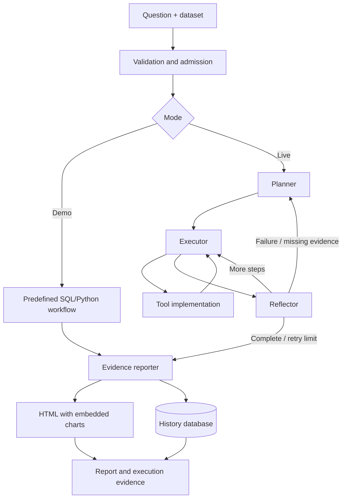

# Architecture

AgentIQ separates the browser interface, analysis API, agent workflow, and tool implementations. The browser never receives provider credentials or the internal API token.

## Request lifecycle

1. Streamlit forwards a question, mode, and optional uploaded dataset ID to FastAPI.
2. FastAPI validates the question and admits one analysis at a time.
3. Demo mode executes a predefined SQL/Python workflow. Live mode invokes LangGraph.
4. The live planner produces an ordered tool plan. The executor obtains tool arguments and records each result.
5. The reflector continues, replans on failures/missing evidence, or finishes. Default reflection uses rules; model reflection is optional.
6. The reporter builds Markdown and HTML from recorded results, embeds charts, and saves the run to SQLite.
7. Streamlit retrieves the saved trace, report, and chart assets for display or download.

## Module boundaries

| Module | Responsibility |
| --- | --- |
| `app/main.py` | HTTP routes, token checking, validation, admission, persistence, and error responses. |
| `app/agent/` | State, planning, execution, reflection, routing, and prompt templates. |
| `app/generation/` | Provider-specific requests, JSON output mode, usage accounting, and estimated costs. |
| `app/datasets.py` | CSV limits, parsing, dataset IDs, and import into `uploaded_data`. |
| `app/tools/` | Read-only SQL, analysis subprocess, files, and optional external adapters. |
| `app/reporting/` | Evidence summaries, Markdown tables, HTML rendering, and embedded chart assets. |
| `app/memory/long_term.py` | Saved analyses in `data/history.db`. |
| `frontend/streamlit_app.py` | Questions, uploads, mode/source selection, history, evidence, and downloads. |

## Design decisions

**Results remain evidence.** The reporter copies successful tool outputs rather than asking an LLM to rewrite findings. This preserves values and dates, but does not prove that generated SQL captures the intended business definition.

**Aggregate in SQL.** Full uploaded datasets are stored in SQLite. SQL computes totals and rankings before results are sent to the model. Large result previews are marked as truncated; charts receive complete rows directly from the most recent successful SQL query.

**Spend model quota where it helps.** Planning and most tool arguments use the provider. Schema inspection, report assembly, and default reflection do not. `LLM_REFLECTION=true` enables additional model checks.

**Isolate process lifetime.** Python analysis executes in a separate process with a 30-second timeout and a unique chart path. Provider credentials are omitted from its environment. This is process separation, not an OS security sandbox.

**Keep deployment simple.** `scripts/start_app.py` starts a loopback-only FastAPI service and public Streamlit interface. It waits for API readiness, forwards a generated internal token, and shuts both processes down if either exits. Docker Compose also supports separate containers with a shared local data mount.

## Storage and data flow

| Location | Contents | Lifetime |
| --- | --- | --- |
| `data/sample_db/agentiq.db` | Synthetic sample tables | Created on first startup if missing. |
| `data/uploads/` | Per-upload SQLite databases | Local or hosting filesystem. |
| `data/history.db` | Saved states and reports | Local or hosting filesystem. |
| `data/reports/` | Generated chart images | Local or hosting filesystem. |

All runtime data is Git-ignored. History is saved-run retrieval, not automatic conversational memory. Runs share a store; there is no per-user partitioning. Free Render storage is temporary. Live analysis sends prompts and selected query results to the configured model provider.

## Boundaries

The app is intended for trusted reviewers. Read-only SQL, validation patterns, a tool budget, and process timeouts provide operational safeguards, not a complete security boundary. Individual accounts, tenant isolation, persistent cloud storage, and worker sandboxing are future production requirements. See [SECURITY.md](../SECURITY.md).
